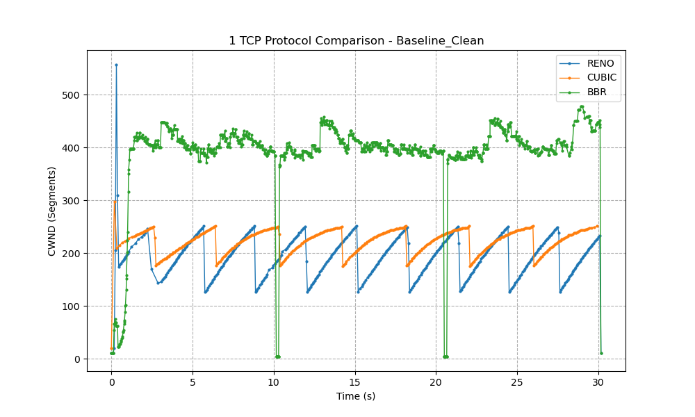
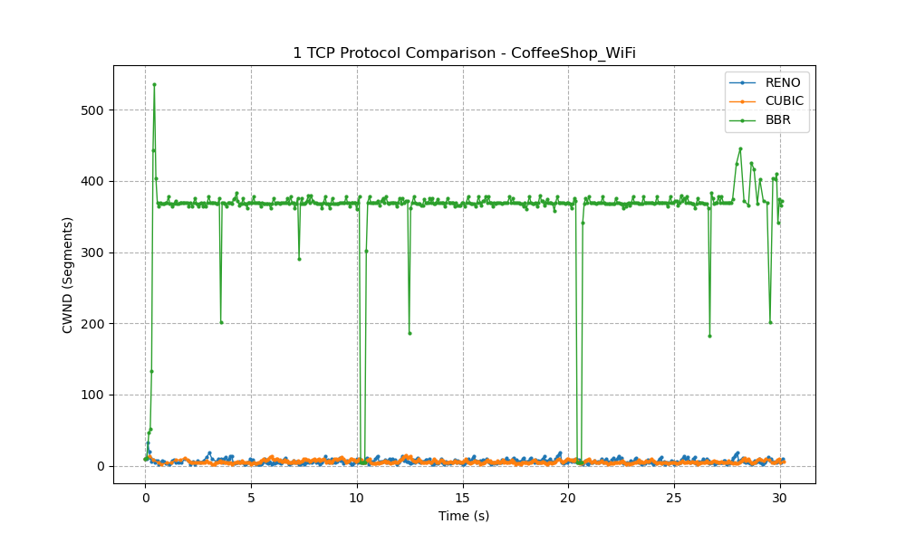
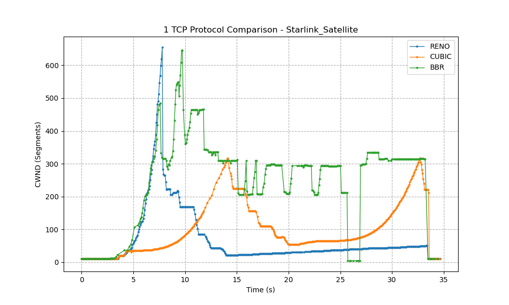
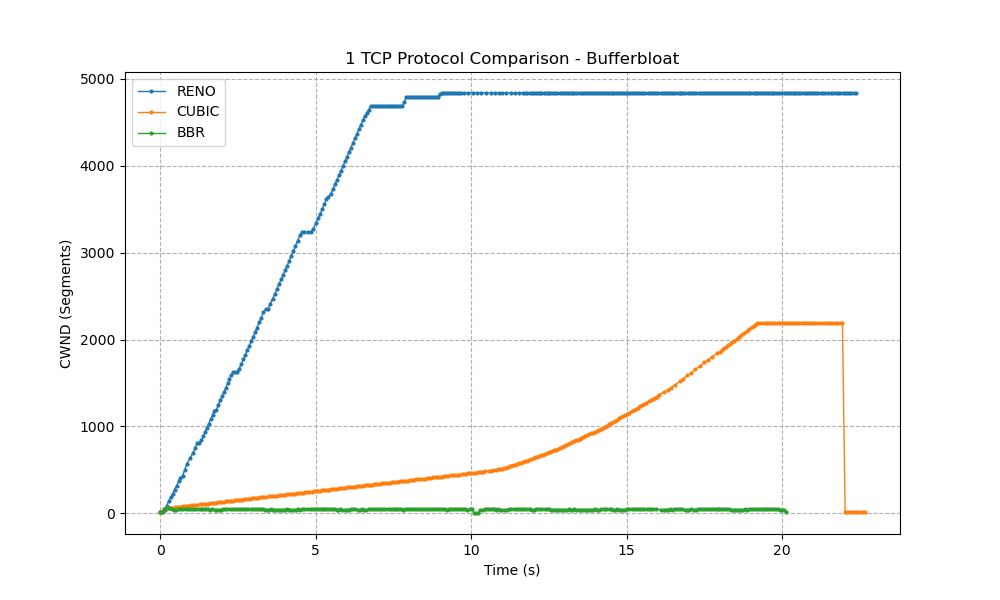

# TCP Congestion Control Benchmarks

Comparative benchmark of TCP congestion control algorithms (**Reno**, **CUBIC**, and **BBR**) evaluated across four simulated network environments using Linux network namespaces and `iproute2`/`tc netem`.

---

## Lab Architecture

The lab isolates traffic across three Linux network namespaces connected by `veth` pairs:

```text
[ client ] 10.0.0.1/24 <---> 10.0.0.2/24 [ router ] 10.0.1.2/24 <---> 10.0.1.1/24 [ server ]
```

- Hardware offloading (TSO/GSO/GRO) is disabled on all interfaces to ensure accurate kernel pacing.
- Network conditions (delay, jitter, loss, rate limits, queue size) are dynamically applied via `tc` on the router interface.

---

## Quickstart

### Prerequisites
- Linux OS with `iproute2`, `iperf3`, `tcpdump`, `python3`, `pandas`, and `matplotlib`.

### 1. Initialize Network Namespaces
```bash
sudo ./setup.sh
```

### 2. Run All Experiments & Generate Plots
```bash
./run_all.sh
```

---

## Benchmark Results

### 1. Baseline (Clean Network)
**Conditions:** 100 Mbps bandwidth, 20ms RTT, 0% packet loss.



- All three algorithms achieve line rate (~94.5 Mbps).
- BBR achieves model-based pacing with **0 retransmissions**.

---

### 2. CoffeeShop Wi-Fi (Lossy Wireless Link)
**Conditions:** 100 Mbps bandwidth, 50ms RTT, **5% random packet loss**.



- **Reno & CUBIC:** Interpret random wireless loss as severe congestion, collapsing throughput to **~3.5–3.8 Mbps**.
- **BBR:** Separates packet loss from congestion estimation, maintaining **91.61 Mbps** throughput.

---

### 3. Starlink Satellite (High Latency & Jitter)
**Conditions:** 50 Mbps bandwidth, **600ms RTT**, **±50ms jitter**.



- Large RTT creates a slow ACK feedback loop.
- **Reno** flatlines at 10 segments; **CUBIC** grows slowly; **BBR** achieves highest sustained throughput (**3.26 Mbps**).

---

### 4. Bufferbloat (Oversized Router Queue)
**Conditions:** 10 Mbps bottleneck, **50,000 packet hardware queue**.



- **Reno & CUBIC:** Blindly scale CWND to several thousand segments searching for a packet drop, filling the queue and inflating latency.
- **BBR:** Measures link BDP floor and caps CWND at **~50 segments**, keeping latency at physical minimum without bloating buffers.

---

## Performance Summary

| Environment | Reno Throughput | Reno Retx | CUBIC Throughput | CUBIC Retx | BBR Throughput | BBR Retx |
| :--- | :---: | :---: | :---: | :---: | :---: | :---: |
| **Baseline (Clean)** | 94.61 Mbps | 18 | 94.61 Mbps | 15 | **94.49 Mbps** | **0** |
| **CoffeeShop Wi-Fi (5% Loss)** | 3.52 Mbps | 121 | 3.84 Mbps | 142 | **91.61 Mbps** | 723 |
| **Starlink Satellite (600ms)** | 0.82 Mbps | 32 | 1.84 Mbps | 45 | **3.26 Mbps** | 761 |
| **Bufferbloat (10Mbps)** | 9.51 Mbps | 0 | 9.51 Mbps | 0 | **9.42 Mbps** | 0 |

---

## Project Structure

```text
├── assets/
│   └── plots/               # Generated CWND comparison plots for README
├── network_benchmarks/
│   └── 1_TCP_Protocol/      # Test suites for each network scenario
│       ├── 0_Baseline_Clean/
│       ├── 1_CoffeeShop_WiFi/
│       ├── 2_Starlink_Satellite/
│       └── 3_Bufferbloat/
├── plot.py                  # Generates CWND graphs from CSV logs
├── generate_stats.py        # Generates aggregate performance tables from JSON
├── run_all.sh               # Orchestrates topology setup, tests, and plotting
├── setup.sh                 # Builds isolated network namespaces and routing
└── .gitignore               # Excludes run traces, logs, reports, and binaries
```
